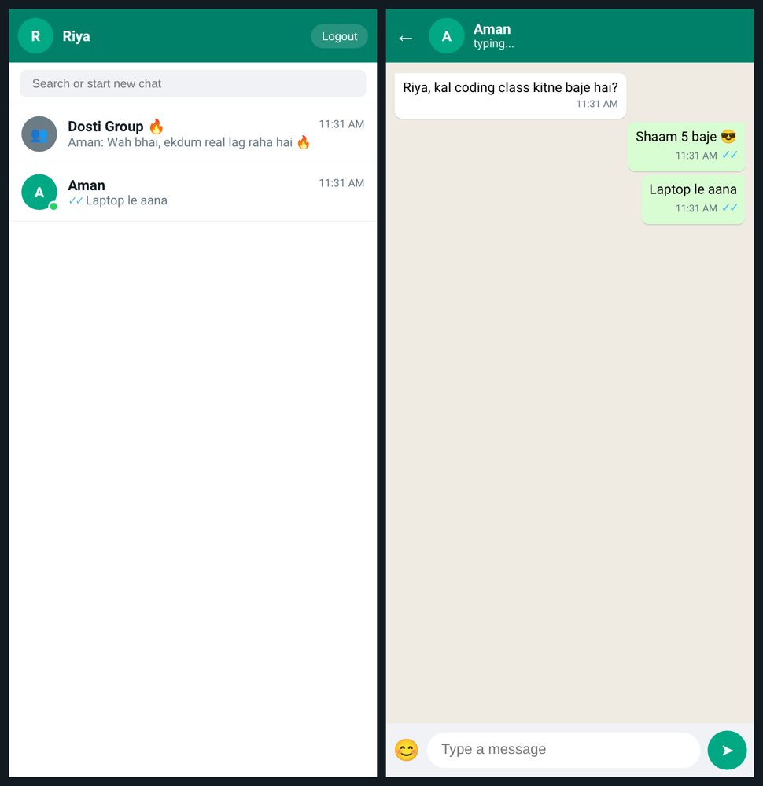

# 💬 WhatsApp Clone — Node.js + Express + Socket.IO

## ⬇️ Download

**Latest release: [v1.0 — WhatsApp Clone](https://github.com/nm621532-byte/whatsapp-clone-techbroz/releases/tag/v1.0)**

- 📦 **App download (zip):** [whatsapp-clone-techbroz-v1.0.zip](https://github.com/nm621532-byte/whatsapp-clone-techbroz/raw/main/release/whatsapp-clone-techbroz-v1.0.zip)
- 🗂 Ya GitHub ka apna **Source code (zip)** — [Releases page](https://github.com/nm621532-byte/whatsapp-clone-techbroz/releases/tag/v1.0) pe neeche "Assets" mein
- ▶️ Chalane ke liye: zip unzip karo → folder mein `npm install` → `npm start` → browser mein **http://localhost:3000**
- 🌐 Bina install kiye try karo: https://whatsapp-clone-live.sites.tab.bot


**Hindi / Hinglish:** Ye ek WhatsApp jaisa **realtime chat app** hai jo humne YouTube video mein bilkul shuru se, step by step banaya hai. Do browser windows kholo, do alag naam se login karo, aur messages turant (live) ek doosre tak pahunchenge — ticks, typing... aur online users ke saath.

**English:** A WhatsApp-style realtime chat app built from scratch in the Tech Bro Z YouTube video. Open two browser windows, log in with two names, and chat live — with ticks, a typing indicator and an online-users list.

🌐 **LIVE demo — phone pe kholo aur chat karo:** https://whatsapp-clone-live.sites.tab.bot

🎬 **YouTube video (Hindi):** https://www.youtube.com/watch?v=LIn-ROf_fGc — [@techbrozdeveloper](https://www.youtube.com/@techbrozdeveloper)



---

## ✨ Features

- 🔐 Login with name + PIN (pehli baar = naya account) + auto avatar; reload pe login yaad rehta hai (secure session token)
- 📱 Phone-friendly: mobile pe WhatsApp jaisa — pehle chat list, tap karo to chat, ← se wapas
- 👥 Group chat ("Dosti Group 🔥") — sabko ek saath message
- 🔒 Private chat — sirf ek dost ke saath (har user ka apna room)
- 🟢 Online users + sab registered users (offline dost ko bhi message karo, wo aate hi padh lega)
- 🔎 Search chats
- ✍️ "typing..." indicator
- ✓ ✓✓ Ticks — sent, delivered aur **blue (read)**, bilkul WhatsApp jaise
- 💾 Messages save hote hain (`data/messages.json`, ya `DATA_DIR` env ka folder) — server restart ke baad bhi chat wapas
- 😀 Emoji picker

## 🛠 Tech Stack

| Part | Kya use kiya |
|------|--------------|
| Frontend | HTML, CSS, vanilla JavaScript |
| Backend | Node.js + Express (static files serve karta hai) |
| Realtime | Socket.IO (WebSocket) |
| Storage | Simple JSON file (`data/messages.json`) — no database needed |

## 🚀 Setup — kaise chalayein (step by step)

**Zaroori:** [Node.js](https://nodejs.org) 18 ya usse naya version, aur [Git](https://git-scm.com).
Check karo: `node -v` aur `git --version`

```bash
# 1. Code download karo (clone)
git clone https://github.com/nm621532-byte/whatsapp-clone-techbroz.git

# 2. Folder ke andar jao
cd whatsapp-clone-techbroz

# 3. Packages install karo (express + socket.io)
npm install

# 4. Server start karo
npm start
```

Terminal mein dikhega: `Server chal raha hai: http://localhost:3000`

5. Browser mein kholo 👉 **http://localhost:3000**
6. Ek **doosri window** (ya incognito) mein **http://127.0.0.1:3000** kholo, alag naam se login karo — aur do users ke beech chat karo! 🎉

> Git nahi hai? GitHub page pe green **Code** button → **Download ZIP** dabao, unzip karo, phir step 2 se shuru karo.

### ✅ Test (2 users + security)

```bash
npm start                     # ek terminal mein server
cd test && npm install        # doosre terminal mein (socket.io-client)
pip install playwright && playwright install chromium
python3 e2e.py http://localhost:3000
```

Ye 2 phone-size browsers khol ke test karta hai: signup/login, group + private message, typing, ✓ ✓✓ blue ticks, reload ke baad history, teesra user private chat nahi dekh sakta, galat PIN lock, XSS, spam limit, aur raw socket tricks.

### 🐞 Common errors (aur fix)

- **`Cannot GET /`** → server `public` folder serve nahi kar raha; `server.js` mein `express.static` line check karo.
- **`EADDRINUSE: address already in use :::3000`** → port 3000 pe pehle se kuch chal raha hai. Purana server band karo (Ctrl + C) ya doosre port pe chalao:
  - Mac/Linux: `PORT=4000 npm start`
  - Windows (PowerShell): `$env:PORT=4000; npm start`
- **`Cannot find module 'express'`** → `npm install` chalana bhool gaye 🙂

## 📁 Folder Structure

```
whatsapp-clone-techbroz/
├── server.js          # Node.js + Express + Socket.IO server (rooms, ticks, typing, save)
├── package.json       # project info + dependencies (express, socket.io)
├── package-lock.json  # exact dependency versions
├── data/
│   └── messages.json  # saved chat messages (starts empty: []); accounts.json / sessions.json yahin bante hain (GitHub pe nahi jaate)
├── test/              # e2e.py (2-user browser test) + attack.js (security test)
├── public/            # frontend (browser mein chalta hai)
│   ├── index.html     # login screen + chat layout
│   ├── style.css      # WhatsApp jaisa design
│   └── app.js         # socket events, chat list, ticks, emoji
└── screenshots/
    └── app.png
```

## 🧠 Kaise kaam karta hai (short mein)

Server = post office, WebSocket = phone call. Browser ek baar server se **connected** rehta hai (Socket.IO), isliye message bhejte hi server use turant sahi insaan (group ya private room) tak forward kar deta hai — page refresh ki zarurat nahi.

## 🏠 Homework

- Image bhejne ka feature jodo 📷
- App ko deploy karo (Render / Railway) aur doston ko link bhejo — live example: https://whatsapp-clone-live.sites.tab.bot
- Comment mein batao kya banaya! 👇

---

## 🙌 Credit

Made by **Tech Bro Z** — YouTube [@techbrozdeveloper](https://www.youtube.com/@techbrozdeveloper), Instagram [@tech_bro_z_1](https://www.instagram.com/tech_bro_z_1/)

Har Sunday ek naye famous app ka full project! ⭐ Repo pasand aaye to **star** karo aur channel **subscribe** karo 🔥

Licensed under the [MIT License](LICENSE) — free to learn, use and modify.
